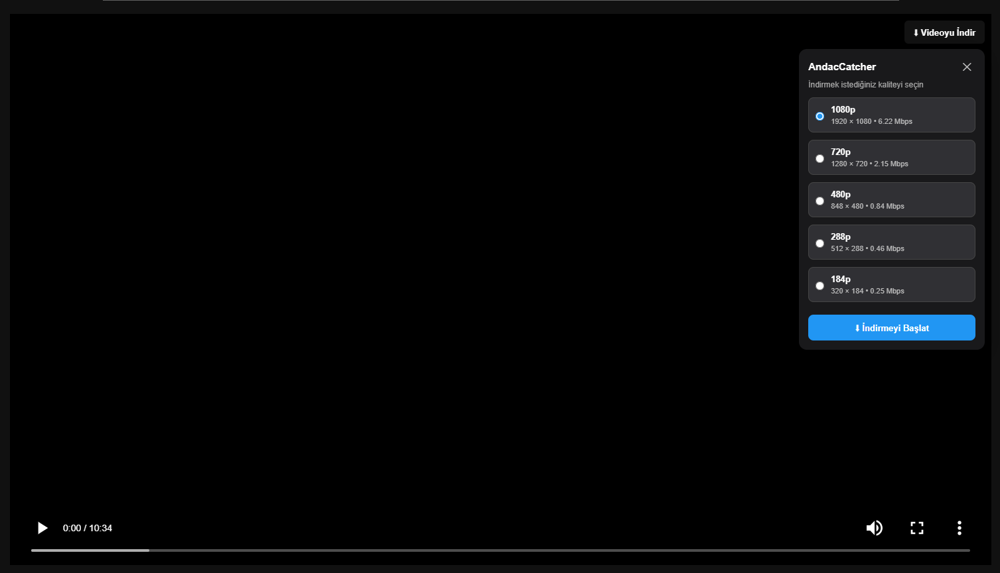
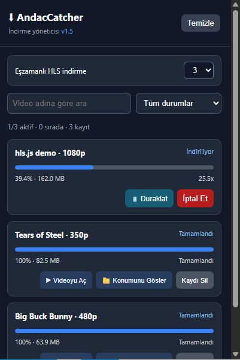

<div align="center">

# AndacCatcher

**A lightweight video downloader for Windows, powered by a Chrome extension, Rust, and FFmpeg.**

[**Download / Releases**](https://github.com/EmreAndac/AndacCatcher/releases) · [**Türkçe Kurulum Rehberi**](README-KURULUM.md) · [**English Installation**](#installation--english)

  

</div>

> [!IMPORTANT]
> **English:** Download the Windows installer from [Releases](https://github.com/EmreAndac/AndacCatcher/releases), **not** the GitHub “Code → Download ZIP” source archive. The installer includes the native downloader and FFmpeg; Chrome requires a one-time manual extension activation.
>
> **Türkçe:** Hazır kurulum dosyasını [Releases](https://github.com/EmreAndac/AndacCatcher/releases) sayfasından indirin. **Code → Download ZIP** seçeneği kaynak kodunu indirir. Kurulum paketi FFmpeg'i içerir; Chrome eklentisini ilk kullanımda bir kez etkinleştirmeniz gerekir.

## Installation / English

**Requirements:** Windows 64-bit and Google Chrome. No Rust, Cargo, FFmpeg, or developer tools need to be installed separately.

1. Open [AndacCatcher Releases](https://github.com/EmreAndac/AndacCatcher/releases) and download **`AndacCatcherSetup-preview.exe`** from the release assets (once published).
2. Run the installer and complete the setup.
3. Open `chrome://extensions` in Google Chrome. The installer may open this page and the installed extension folder for you.
4. Turn on **Developer mode** in the upper-right corner.
5. Click **Load unpacked** and select the folder below (paste the path into File Explorer's address bar if needed):

   ```text
   %LOCALAPPDATA%\Programs\AndacCatcher\extension
   ```

6. Confirm the folder. The AndacCatcher extension should appear in Chrome. Pin it from Chrome's extensions menu if you like.
7. Open a page with a supported video, start playback, and use AndacCatcher to detect and download available media.

**Do not enter or change an extension ID manually.** The packaged extension contains a fixed public key, and the installer registers the matching Native Messaging host automatically.

> [!TIP]
> If Chrome does not show a video source, refresh the page and start the video before opening the extension. Some websites do not expose downloadable media URLs.

**Need Turkish instructions?** See the [step-by-step Turkish setup guide](README-KURULUM.md).

## Features

- Detects supported video elements and media requests in Chrome
- HLS (`.m3u8`) quality selection when variant information is available
- HLS-to-MP4 downloads using FFmpeg through a Rust native host
- Download progress, cancellation, and experimental pause/resume on Windows
- Configurable concurrent HLS downloads (1–3), with a reorderable queue
- Persistent download history, search, status filters, and removal of individual entries
- Open a completed download or reveal it in File Explorer
- Direct-download handling for some non-HLS video URLs via Chrome

> [!NOTE]
> **Preview limitations:** Not all websites expose usable media URLs. DRM-protected content is not supported. Some streams reject FFmpeg requests (for example, HTTP 403). Pause/resume does not survive browser or computer restarts. Embedded-player detection is still being improved.

## Screenshots

### Video Quality Selection



### Download Manager



## How it works

| Component | Technology | Purpose |
| --- | --- | --- |
| Browser extension | JavaScript, HTML, CSS, Chrome Manifest V3 | Detects media and displays controls |
| Native host | Rust | Handles native download tasks |
| Media processing | FFmpeg / FFprobe | Processes supported media streams |
| Communication | Chrome Native Messaging | Connects the extension to the native host |
| Installer | Inno Setup | Installs binaries, extension files, and Native Messaging registration |

## Repository layout

```text
AndacCatcher/
├── extension/             # Chrome extension
├── desktop/               # Rust native host
│   ├── Cargo.toml
│   └── src/
├── installer/             # Inno Setup scripts
├── licenses/ffmpeg/       # FFmpeg notices and license documents
├── README.md              # English project overview
└── README-KURULUM.md      # Turkish installation and build guide
```

`vendor/` and compiled installer outputs are intentionally not tracked in Git. The release installer is distributed separately through GitHub Releases.

## Build from source / Developers

These steps are **only for developers**. End users should use the installer above.

1. Install Rust/Cargo, Inno Setup, and a compatible Windows build of FFmpeg and FFprobe.
2. Clone the repository:

   ```powershell
   git clone https://github.com/EmreAndac/AndacCatcher.git
   cd AndacCatcher
   ```

3. Put `ffmpeg.exe` and `ffprobe.exe` in `vendor/` (review their distribution licenses).
4. Build the Rust host and installer:

   ```powershell
   cd desktop
   cargo build --release
   cd ..
   .\installer\build.ps1
   ```

5. The installer is generated at `installer/output/AndacCatcherSetup-preview.exe` if the build succeeds.

The native messaging host name is **`com.videocatcher.downloader`**. Keep the packaged extension's public `manifest.json` key and the installer's `allowed_origins` ID consistent. Do not commit private `.pem` keys or machine-specific credentials.

## Troubleshooting

- **Extension not visible:** Check `chrome://extensions`, enable Developer mode, and load the installed `extension` folder.
- **Native host connection error:** Make sure the Windows installer completed successfully and the extension came from the installed folder. Reinstall the latest matching package if needed.
- **Video not detected:** Refresh the tab, start playback, and try again. Some sources are unsupported.
- **Windows security warning:** This is a preview installer and may not be code-signed. Verify the download comes from this repository's Releases page; do not disable security protections just to run it.

## Responsible use and licensing

Download only videos you own or are authorized to download. Respect copyright, website terms, and applicable law. AndacCatcher does not bypass DRM or access restrictions.

The bundled Gyan.dev FFmpeg 9.0.2 Essentials build reports **GPL-3.0-or-later**. Redistributing FFmpeg binaries requires compliance with the applicable GPL terms, including access to the complete corresponding source code and required build materials. See `licenses/ffmpeg/` and [FFmpeg's legal guidance](https://ffmpeg.org/legal.html). A license for AndacCatcher's own source code has not yet been selected; public visibility alone does not grant redistribution or modification rights.

**Project status:** Experimental preview; features and packaging may change.
